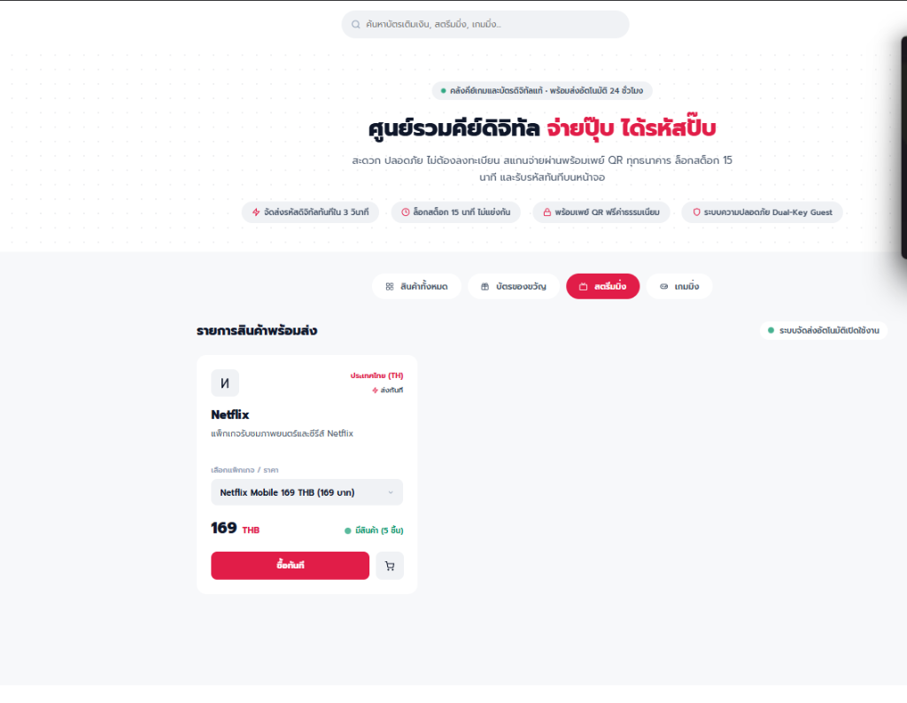
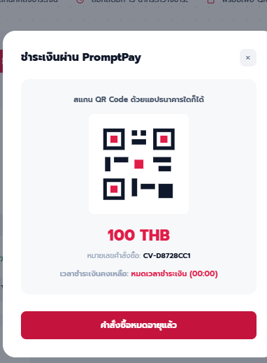
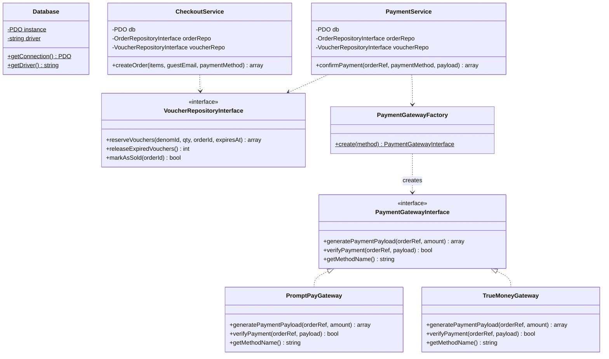
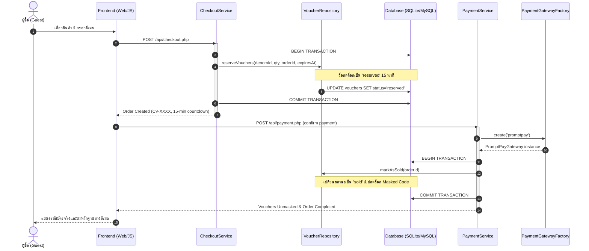

# CARDVAULT — Digital Voucher & Key Marketplace
> **ระบบร้านค้าจำหน่ายคีย์ดิจิทัลและบัตรของขวัญออนไลน์ (G2A-Style Marketplace)**  
> พัฒนาด้วยภาษา **PHP (Modern OOP & OOAD Architecture)** โดยเน้นสถาปัตยกรรมระดับองค์กร (Clean 3-Tier Layered Architecture), การประยุกต์ใช้ Design Patterns, หลักการ SOLID และระบบความปลอดภัยระดับสูง

---

## 📸 ตัวอย่างหน้าจอระบบ (Screenshots)

### 1. หน้าแรกของร้านค้า (Storefront Catalog & Instant Purchase)
แสดงแคตตาล็อกสินค้า บัตรของขวัญ และคีย์ดิจิทัล พร้อมระบบกรองหมวดหมู่ การคำนวณราคาแบบเรียลไทม์ และระบบตรวจสอบสถานะสต็อกอัตโนมัติ



### 2. ระบบชำระเงินและล็อกสต็อกสินค้า (Checkout & Concurrency Reservation)
เมื่อผู้ซื้อทำการสั่งซื้อ ระบบจะสร้าง Order พร้อมล็อกสต็อกบัตร (Voucher Reservation) เป็นเวลา 15 นาที พร้อมตัวนับเวลาถอยหลัง (Countdown Timer) และระบบสร้าง PromptPay QR Code อัตโนมัติ ป้องกันปัญหาการแย่งซื้อสินค้า (Race Condition)



---

## 🏛️ สถาปัตยกรรมระบบ (System Architecture)

โปรเจกต์นี้ได้รับการออกแบบตามหลัก **Clean 3-Tier Layered Architecture** เพื่อแยกส่วนความรับผิดชอบ (Separation of Concerns) ทำให้โค้ดมีความยืดหยุ่น ง่ายต่อการทดสอบ (Testable) และดูแลรักษาในระยะยาว:

```
┌────────────────────────────────────────────────────────┐
│             Presentation Layer (Web & REST API)        │
│   public/index.php, public/admin.php, public/api/*     │
└──────────────────────────┬─────────────────────────────┘
                           │ uses
┌──────────────────────────▼─────────────────────────────┐
│                 Service Layer (Business Logic)         │
│   CatalogService, CheckoutService, PaymentService,     │
│   OrderTrackingService, OtpService, AdminService       │
└──────────────────────────┬─────────────────────────────┘
                           │ depends on (Interfaces)
┌──────────────────────────▼─────────────────────────────┐
│           Domain & Data Access Layer (Contracts)       │
│   Contracts: CatalogRepoInterface, OrderRepoInterface │
│              VoucherRepoInterface, PaymentGatewayInterface │
│   Repositories: CatalogRepository, OrderRepository,    │
│                 VoucherRepository                      │
│   Models: Platform, Category, Denomination,            │
│           Order, Voucher                               │
└──────────────────────────┬─────────────────────────────┘
                           │ uses
┌──────────────────────────▼─────────────────────────────┐
│               Infrastructure Layer (Config)            │
│   Database (Singleton, Multi-driver MySQL / SQLite)    │
└────────────────────────────────────────────────────────┘
```

---

## 🧩 การวิเคราะห์และออกแบบเชิงวัตถุ (OOAD: Object-Oriented Analysis & Design)

### 1. การประยุกต์ใช้ Design Patterns ในระบบ

| Design Pattern | ไฟล์ที่ประยุกต์ใช้ | บทบาทและหน้าที่ในสถาปัตยกรรม |
| :--- | :--- | :--- |
| **Singleton Pattern** | `src/Config/Database.php` | ควบคุมการเชื่อมต่อฐานข้อมูล PDO ให้มีเพียง Instance เดียวตลอดรอบคำขอ รองรับ Multi-Driver (MySQL อัตโนมัติ และ Fallback ไป SQLite แบบ Zero-Config) |
| **Strategy Pattern** | `src/Contracts/PaymentGatewayInterface.php`<br>`src/Services/Payment/PromptPayGateway.php`<br>`src/Services/Payment/TrueMoneyGateway.php` | นิยามอัลกอริทึมและพฤติกรรมการชำระเงินใน Interface เดียวกัน ทำให้สามารถสลับช่องทางการชำระเงินได้แบบ Dynamic โดยไม่ต้องแก้ไขโค้ดหลักของระบบ |
| **Factory Method Pattern** | `src/Services/Payment/PaymentGatewayFactory.php` | ทำหน้าที่สร้าง Instance ของ Gateway ตามชื่อผู้ให้บริการที่ส่งเข้ามา พร้อมตรวจสอบความถูกต้องของช่องทางชำระเงิน |
| **Repository Pattern** | `src/Repositories/CatalogRepository.php`<br>`src/Repositories/OrderRepository.php`<br>`src/Repositories/VoucherRepository.php` | แยกการเข้าถึงข้อมูล (Data Persistence Layer) ออกจาก Business Logic โดยสื่อสารผ่าน Interfaces (`src/Contracts/`) |
| **Service Layer Pattern** | `src/Services/*.php` | เป็นตัวกลางในการจัดการ Workflow ธุรกิจและรวบรวมการทำงานข้าม Repositories เช่น การทำ Database Transaction, การจับเวลา และการสุ่มรหัส OTP |

---

### 2. หลักการ SOLID Principles ในโปรเจกต์

- **S — Single Responsibility Principle (SRP):**  
  แต่ละคลาสมีความรับผิดชอบเดียว เช่น `CheckoutService` ดูแลเฉพาะการสร้างคำสั่งซื้อและการจองสต็อก, `PaymentService` ดูแลการรับชำระและปลดล็อกคีย์, `OtpService` ดูแลการสร้างและตรวจสอบรหัส OTP สำหรับ Guest
- **O — Open/Closed Principle (OCP):**  
  ระบบรองรับการขยายโดยไม่ต้องแก้ไขโค้ดเดิม ตัวอย่างเช่น เมื่อต้องการเพิ่มช่องทางชำระเงินใหม่ (เช่น `StripeGateway` หรือ `CreditCardGateway`) สามารถสร้างคลาสใหม่ที่ `implements PaymentGatewayInterface` ได้ทันที โดยไม่ต้องแก้ไขโค้ดใน `CheckoutService` หรือ `OrderRepository`
- **L — Liskov Substitution Principle (LSP):**  
  คลาสลูกหรือคลาสที่ Implement Interface สามารถใช้งานแทนกันได้อย่างสมบูรณ์ เช่น `PromptPayGateway` และ `TrueMoneyGateway` ปฏิบัติตามสัญญาของ `PaymentGatewayInterface` โดยส่งออกข้อมูลผลลัพธ์ในรูปแบบเดียวกัน
- **I — Interface Segregation Principle (ISP):**  
  ไม่มี Interface ที่ใหญ่เกินความจำเป็น มีการแยกย่อยตามขอบเขตงาน เช่น `CatalogRepositoryInterface`, `OrderRepositoryInterface`, และ `VoucherRepositoryInterface`
- **D — Dependency Inversion Principle (DIP):**  
  คลาสระดับสูง (High-level Services) ไม่พึ่งพาคลาสระดับล่าง (Concrete Repositories) โดยตรง แต่พึ่งพาผ่าน Abstraction (`Contracts`) และรับการส่งมอบ Dependencies ผ่าน **Constructor Dependency Injection**

---

## 🧬 การเขียนโปรแกรมเชิงวัตถุ (OOP: Object-Oriented Programming)

### 4 เสาหลักของ OOP (4 Pillars of OOP) ที่ปรากฏในโค้ด:

#### 1. Encapsulation (การห่อหุ้มและการซ่อนข้อมูล)
- ข้อมูลและสถานะภายในของ Entity ถูกกำหนดให้เป็น `private` หรือ `protected`
- ป้องกันการเข้าถึงและแก้ไขข้อมูลโดยตรงจากภายนอก มีเมธอด Getter/Setter และเมธอดจัดการสถานะเฉพาะทาง
- **ตัวอย่างในคลาส `Voucher` (`src/Models/Voucher.php`):**
  ```php
  class Voucher
  {
      private int $id;
      private string $code;
      private string $status; // 'available', 'reserved', 'sold'

      // ซ่อนรหัสบัตรจริงจนกว่าคำสั่งซื้อจะได้รับการชำระเงินสำเร็จ
      public function maskCode(): string
      {
          return '••••-••••-••••-' . substr($this->code, -4);
      }

      public function getPlainCode(bool $isAuthorized): string
      {
          if (!$isAuthorized) {
              return $this->maskCode();
          }
          return $this->code;
      }
  }
  ```

#### 2. Abstraction (การสร้างสิ่งนามธรรม)
- การสร้างสัญญา (Contracts) ผ่าน PHP Interfaces เพื่อระบุว่าระบบต้องการเมธอดใดบ้าง โดยไม่ต้องผูกมัดกับรายละเอียดเชิงเทคนิค
- **ตัวอย่างใน `PaymentGatewayInterface` (`src/Contracts/PaymentGatewayInterface.php`):**
  ```php
  interface PaymentGatewayInterface
  {
      public function generatePaymentPayload(string $orderRef, float $amount): array;
      public function verifyPayment(string $orderRef, array $payload): bool;
      public function getMethodName(): string;
  }
  ```

#### 3. Polymorphism (การพ้องรูป)
- สามารถเรียกใช้เมธอดที่มีชื่อเดียวกัน แต่ให้การทำงานที่แตกต่างกันไปตามอ็อบเจกต์ที่ถูกเรียก
- ตัวอย่างเช่น การเรียกเมธอด `generatePaymentPayload()` ผ่าน `PaymentGatewayInterface` จะได้ผลลัพธ์เป็น PromptPay QR Code หรือ TrueMoney Deep Link ตามที่ถูก Factory สร้างขึ้นมา

#### 4. Inheritance & Domain Hierarchy
- การจัดโครงสร้างความสัมพันธ์ของหมวดหมู่และโมเดลตามความเป็นจริง:
  `Category` (1) ── (N) `Platform` (1) ── (N) `Denomination` (1) ── (N) `Voucher`

---

## 📊 แผนภาพระบบ (System Diagrams)

### Class Diagram


---

### Sequence Diagram: วงจรคำสั่งซื้อและการชำระเงิน (Checkout & Fulfillment)


---

## 🛡️ กลไกความปลอดภัยและระบบ Concurrency

1. **Two-Phase Concurrency Control & Row-Level Reservation:**
   - ใช้ Database Transaction (`BEGIN TRANSACTION ... COMMIT`) ในการสั่งซื้อ
   - ล็อกแถวข้อมูลบัตรที่สถานะเป็น `available` ให้กลายเป็น `reserved` ภายในคำสั่งซื้อเดียว เพื่อป้องกันไม่ให้เกิดการซื้อชนกัน (Double Spending / Race Conditions) แม้มีผู้ใช้งานจำนวนมากกดสั่งซื้อพร้อมกัน
2. **Lazy Sweep Pattern (การกวาดคืนสต็อกแบบอัตโนมัติ):**
   - เมื่อคำสั่งซื้อใดไม่ได้รับการชำระเงินภายใน 15 นาที ระบบจะตรวจจับและคืนสถานะบัตรกลับสู่ `available` อัตโนมัติเมื่อมีการโหลดหน้าร้านหรือมีคำสั่งซื้อใหม่ โดยไม่ต้องพึ่งพา Cron Job ภายนอก
3. **Dual-Key Guest Security Model:**
   - ลูกค้าทั่วไป (Guest Checkout) ไม่ต้องสมัครสมาชิก แต่รักษาความปลอดภัยด้วยหลักการ Dual-Key คือต้องระบุทั้ง **หมายเลขคำสั่งซื้อ (Order Reference)** และ **อีเมลที่ใช้สั่งซื้อ (Guest Email)** ให้ตรงกันจึงจะสามารถดูประวัติคำสั่งซื้อได้
4. **2FA One-Time Password (OTP):**
   - การดูรหัสคีย์ย้อนหลังในระบบ Tracking ต้องผ่านการยืนยันรหัส OTP 6 หลักที่ส่งไปยังอีเมลผู้ซื้อ มีอายุ 5 นาที และป้องกัน Brute-Force

---

## 🚀 การติดตั้งและเริ่มใช้งาน (Getting Started)

### ความต้องการของระบบ (Prerequisites)
- **PHP** เวอร์ชัน 8.1 ขึ้นไป
- ส่วนขยาย PHP: `pdo`, `pdo_sqlite` หรือ `pdo_mysql`

### วิธีการรันระบบ (Windows & CLI)

1. **เปิดเซิร์ฟเวอร์แบบทันที (One-Click Runner):**
   ดับเบิลคลิกที่ไฟล์:
   ```cmd
   run.bat
   ```
   หรือรันผ่านคำสั่ง Terminal:
   ```bash
   php -S localhost:8000 -t public
   ```

2. **เปิดหน้าเว็บในเบราว์เซอร์:**
   - หน้าร้านค้า (Storefront): [http://localhost:8000](http://localhost:8000)
   - หน้าผู้ดูแลระบบ (Admin Panel): [http://localhost:8000/admin.php](http://localhost:8000/admin.php)
     - **Username:** `admin`
     - **Password:** `admin1234`

3. **การรันชุดทดสอบ (Automated Test Suite):**
   ดับเบิลคลิกไฟล์ `test.bat` หรือรัน:
   ```bash
   php tests/DatabaseTest.php
   php tests/CatalogTest.php
   php tests/CheckoutTest.php
   php tests/PaymentTest.php
   php tests/TrackingOtpTest.php
   php tests/AdminTest.php
   php tests/OopArchitectureTest.php
   ```

---

## 📁 โครงสร้างโปรเจกต์ (Project Structure)

```
mini-project-oop/
├── .gitignore
├── composer.json               # คำอธิบายแพ็กเกจและการแมป PSR-4
├── run.bat                     # สคริปต์เปิด Development Server
├── test.bat                    # สคริปต์รัน Automated Test Suite
├── database/
│   └── cardvault.sqlite        # ฐานข้อมูล SQLite เริ่มต้น (Auto-seeded)
├── docs/
│   └── screenshots/            # ภาพตัวอย่างหน้าจอระบบ
├── public/                     # Document Root (Web Server)
│   ├── index.php               # หน้าร้านค้าหลัก
│   ├── admin.php               # แผงควบคุมระบบของผู้ดูแล
│   ├── api/                    # RESTful Endpoints (JSON)
│   │   ├── products.php
│   │   ├── checkout.php
│   │   ├── payment.php
│   │   ├── track.php
│   │   ├── otp.php
│   │   └── admin.php
│   └── assets/
│       ├── css/style.css
│       └── js/app.js, admin.js
├── src/                        # Core Application Source (OOP / OOAD)
│   ├── autoload.php            # Standalone PSR-4 Autoloader
│   ├── Config/
│   │   └── Database.php        # Database Connection (Singleton)
│   ├── Contracts/              # Abstractions (Interfaces)
│   │   ├── CatalogRepositoryInterface.php
│   │   ├── OrderRepositoryInterface.php
│   │   ├── PaymentGatewayInterface.php
│   │   └── VoucherRepositoryInterface.php
│   ├── Models/                 # Domain Entities (Encapsulated)
│   │   ├── Category.php
│   │   ├── Denomination.php
│   │   ├── Order.php
│   │   ├── Platform.php
│   │   └── Voucher.php
│   ├── Repositories/           # Data Access Layer
│   │   ├── CatalogRepository.php
│   │   ├── OrderRepository.php
│   │   └── VoucherRepository.php
│   └── Services/               # Business Logic Layer
│       ├── CatalogService.php
│       ├── CheckoutService.php
│       ├── PaymentService.php
│       ├── OrderTrackingService.php
│       ├── OtpService.php
│       ├── AdminService.php
│       └── Payment/
│           ├── PaymentGatewayFactory.php
│           ├── PromptPayGateway.php
│           └── TrueMoneyGateway.php
└── tests/                      # Automated Unit & Integration Tests
    ├── DatabaseTest.php
    ├── CatalogTest.php
    ├── CheckoutTest.php
    ├── PaymentTest.php
    ├── TrackingOtpTest.php
    ├── AdminTest.php
    └── OopArchitectureTest.php
```

---

## 📄 ใบอนุญาต (License)
โปรเจกต์นี้เผยแพร่ภายใต้ใบอนุญาต [MIT License](LICENSE)
