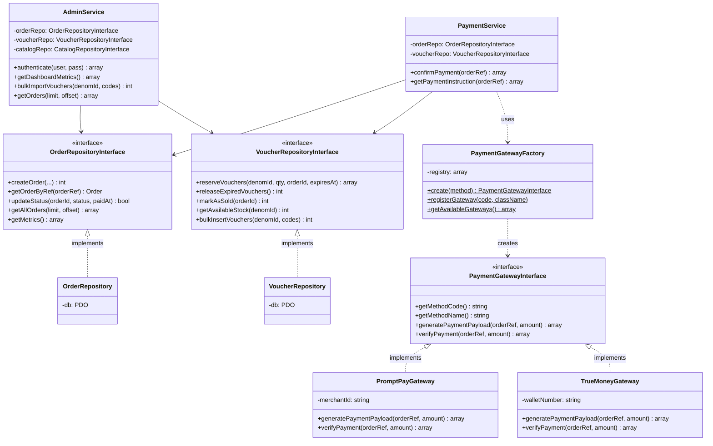
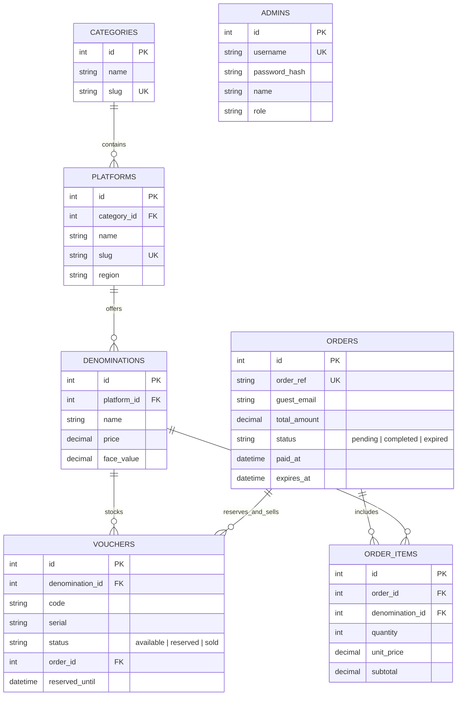

# CARDVAULT: สถาปัตยกรรมเชิงวัตถุ (OOP Architecture Document)

เอกสารฉบับนี้อธิบายโครงสร้างเชิงวัตถุ (Object-Oriented Programming) และรูปแบบการออกแบบซอฟต์แวร์ (Design Patterns) ที่นำมาประยุกต์ใช้ในโครงการ **CARDVAULT Digital Key Marketplace** เพื่อรองรับทั้งการประเมินวิชาการเขียนโปรแกรมเชิงวัตถุ (OOP Course Evaluation) และความพร้อมในการปฏิบัติงานจริงของร้านค้าจำหน่ายคีย์ดิจิทัล

---

## 1. การประยุกต์ใช้เสาหลัก OOP ทั้ง 4 ด้าน (The 4 Pillars of OOP)

### 1.1 การห่อหุ้มและการซ่อนรายละเอียด (Encapsulation & Information Hiding)
- **ตำแหน่งในโค้ด**: โฟลเดอร์ `src/Models/` เช่น [`src/Models/Voucher.php`](file:///d:/_Work/mini-project-oop/src/Models/Voucher.php) และ [`src/Models/Order.php`](file:///d:/_Work/mini-project-oop/src/Models/Order.php)
- **หลักการ**:
  - กำหนดแอตทริบิวต์ทั้งหมดเป็น `private` เช่น `$id`, `$code`, `$status`, `$totalAmount` ป้องกันการเข้าถึงหรือแก้ไขข้อมูลโดยตรงจากภายนอก
  - เข้าถึงผ่าน Getter เมธอดที่มี Type-Hinting เข้มงวด
  - **Business Logic Encapsulation**: ซ่อนการประมวลผลการมาสก์รหัส PIN ไว้ในเมธอด `getMaskedCode()` ของ Voucher โดยตรง หากบัตรยังไม่ถูกจำหน่าย (`$status !== 'sold'`) ตัวโมเดลจะแปลงรหัสให้เป็นจุดกระสุนปิดบัง เช่น `••••-••••-••••-1234` อัตโนมัติ

### 1.2 การนามธรรม (Abstraction & Contracts)
- **ตำแหน่งในโค้ด**: โฟลเดอร์ `src/Contracts/`
  - [`src/Contracts/PaymentGatewayInterface.php`](file:///d:/_Work/mini-project-oop/src/Contracts/PaymentGatewayInterface.php)
  - [`src/Contracts/VoucherRepositoryInterface.php`](file:///d:/_Work/mini-project-oop/src/Contracts/VoucherRepositoryInterface.php)
  - [`src/Contracts/OrderRepositoryInterface.php`](file:///d:/_Work/mini-project-oop/src/Contracts/OrderRepositoryInterface.php)
  - [`src/Contracts/CatalogRepositoryInterface.php`](file:///d:/_Work/mini-project-oop/src/Contracts/CatalogRepositoryInterface.php)
- **หลักการ**:
  - กำหนดพฤติกรรม (Contracts) ที่ระบบต้องการโดยไม่ต้องผูกติดกับเทคโนโลยีฐานข้อมูลหรือผู้ให้บริการชำระเงิน
  - คลาสระดับบริการ (Services) ทำงานผ่าน Interface (Dependency Inversion Principle) ทำให้สามารถสลับเปลี่ยนไดรเวอร์ หรือทำ Mock ใน Unit Test ได้อย่างสมบูรณ์

### 1.3 ความหลากหลายทางชีวภาพ (Polymorphism & Strategy Pattern)
- **ตำแหน่งในโค้ด**: โฟลเดอร์ `src/Services/Payment/`
  - [`src/Services/Payment/PromptPayGateway.php`](file:///d:/_Work/mini-project-oop/src/Services/Payment/PromptPayGateway.php)
  - [`src/Services/Payment/TrueMoneyGateway.php`](file:///d:/_Work/mini-project-oop/src/Services/Payment/TrueMoneyGateway.php)
- **หลักการ**:
  - ทั้ง `PromptPayGateway` และ `TrueMoneyGateway` ต่าง Implement อินเตอร์เฟซ `PaymentGatewayInterface`
  - คลาส [`PaymentService`](file:///d:/_Work/mini-project-oop/src/Services/PaymentService.php) สามารถเรียกเมธอด `generatePaymentPayload()` หรือ `verifyPayment()` แบบ Polymorphic โดยไม่ต้องเขียน if-else แยกประเภทสำหรับทุกขั้นตอน

### 1.4 การสืบทอดและการขยายระบบ (Inheritance & Extensibility)
- ระบบเปิดโอกาสให้เพิ่มช่องทางชำระเงินใหม่ (เช่น บัตรเครดิต, Crypto Gateway) ได้ง่ายโดย Implement `PaymentGatewayInterface` แล้วลงทะเบียนเข้าสู่ Factory โดยไม่ต้องแก้ไขโค้ดเดิม (Open-Closed Principle)

---

## 2. รูปแบบการออกแบบที่นำมาใช้ (Design Patterns)

| รูปแบบ (Design Pattern) | ไฟล์ที่นำไปใช้ | วัตถุประสงค์และการทำงาน |
|---|---|---|
| **Singleton Pattern** | [`src/Config/Database.php`](file:///d:/_Work/mini-project-oop/src/Config/Database.php) | ควบคุมการเชื่อมต่อฐานข้อมูลให้มีเพียง 1 Connection Instance ตลอดอายุคำขอ และมีระบบสลับจาก MySQL ไป SQLite อัตโนมัติ |
| **Factory Pattern** | [`src/Services/Payment/PaymentGatewayFactory.php`](file:///d:/_Work/mini-project-oop/src/Services/Payment/PaymentGatewayFactory.php) | รับผิดชอบการสร้างอ็อบเจกต์ Gateway ตามรหัสช่องทางชำระเงิน (`promptpay`, `truemoney`) |
| **Repository Pattern** | โฟลเดอร์ `src/Repositories/` | แยกการสืบค้นข้อมูล (SQL Queries / Persistence) ออกจากตรรกะทางธุรกิจของระบบอย่างเด็ดขาด |
| **Service Layer Pattern** | โฟลเดอร์ `src/Services/` | รวบรวมตรรกะทางธุรกิจหลัก (Use-Cases) เช่น การจองสต็อก 15 นาที, การตรวจสอบ OTP, การออกรายงานสรุป |
| **Domain Entity Pattern** | โฟลเดอร์ `src/Models/` | เก็บสถานะและกฎเกณฑ์ของเอนทิตี เช่น สถานะคำสั่งซื้อ, การมาสก์รหัส PIN |

---

## 3. แผนภาพคลาสความสัมพันธ์ (Mermaid Class Diagram)



---

## 4. แผนภาพฐานข้อมูล (Entity-Relationship Diagram)



---

## 5. การทดสอบยืนยันระบบ (Automated Test Verification)

โครงการมีชุดทดสอบอัตโนมัติ 7 ชุด ครอบคลุมทั้งตรรกะฐานข้อมูล โครงสร้าง OOP และระบบหลังบ้าน:

```bash
php tests/DatabaseTest.php
php tests/CatalogTest.php
php tests/CheckoutTest.php
php tests/PaymentTest.php
php tests/TrackingOtpTest.php
php tests/AdminTest.php
php tests/OopArchitectureTest.php
```

ทุกชุดทดสอบผ่านสมบูรณ์ **100% (All Assertions Passed)**
